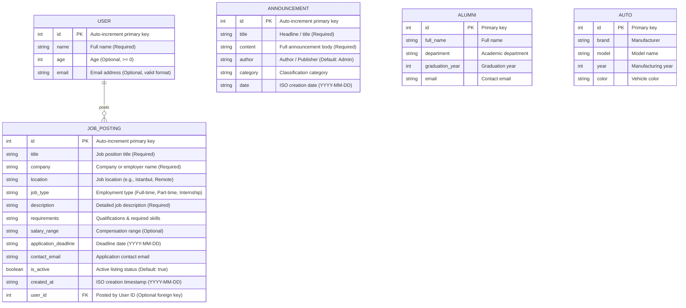

# Data Design Document (DDD)

[← Back to Project README](README.md)

**Project:** Classroom MVC REST API & Management System  
**Version:** 1.0.0  
**Status:** Approved / Active  
**Author:** Department of Management Information Systems  

---

## 1. Executive Summary & Objective

The **Data Design Document (DDD)** details the data architecture, entity definitions, schema specifications, constraints, and persistence lifecycle for the application.

This document serves as the formal specification for:
1. **Domain Entities:** Data models for `User`, `Announcement`, and `JobPosting` (`job_postings` table) (and legacy reference entities `Alumni` and `Auto`).
2. **Data Dictionary:** Comprehensive schema specifications, data types, constraints, and validation rules.
3. **Entity Relationships (ERD):** Structural representation of system entities.
4. **Data Lifecycle & Storage Strategy:** In-memory state management, container lifecycle impact (*The Forgetting Test*), and the roadmap for persistent volume storage.

---

## 2. Conceptual Data Architecture

The application adopts the **Model-View-Controller (MVC)** architectural pattern. The **Model Layer** encapsulates:
* **Entity Schemas:** Pydantic models enforcing structural typing and request/response validation.
* **In-Memory Repositories:** Class-based models (`UserModel`, `AnnouncementModel`, `JobPostingModel`) managing collection state without an external database connection.
* **CRUD Abstraction:** Clean separation between data manipulation methods and controller routing.

```
  +-------------------------------------------------------------+
  |                      CONTROLLER LAYER                       |
  |       (UserController, AnnouncementController, APIs)        |
  +-------------------------------------------------------------+
                                 │
                 Validates payload using Pydantic
                                 ▼
  +-------------------------------------------------------------+
  |                         MODEL LAYER                         |
  |  +--------------------+             +--------------------+  |
  |  |     UserModel      |             | AnnouncementModel  |  |
  |  +--------------------+             +--------------------+  |
  |  | - _users: List     |             | - _announcements   |  |
  |  | - _next_id: int    |             | - _next_id: int    |  |
  |  | - create()         |             | - create()         |  |
  |  | - get_all()        |             | - get_all()        |  |
  |  | - get_by_id()      |             | - get_by_id()      |  |
  |  | - update()         |             | - update()         |  |
  |  | - patch()          |             | - patch()          |  |
  |  | - delete()         |             | - delete()         |  |
  |  +--------------------+             +--------------------+  |
  +-------------------------------------------------------------+
                                 │
                    Volatile Execution Context
                                 ▼
  +-------------------------------------------------------------+
  |                    IN-MEMORY RAM STORAGE                    |
  |       (Ephemeral Container Memory - Non-persistent)         |
  +-------------------------------------------------------------+
```

---

## 3. Entity-Relationship Diagram (ERD)



---

## 4. Data Dictionary & Schema Specifications

### 4.1. `User` Entity

The `User` entity models individual system users for both web directory management and programmatic REST API consumption.

| Field Name | Data Type | Nullable | Default | Constraints & Rules | Description |
|---|---|---|---|---|---|
| `id` | `Integer` | No | Auto-increment | Primary Key, Unique, Generated by system | Unique identifier for the user record. |
| `name` | `String` | No | None | `min_length=1`, Whitespace trimmed | Full legal name of the user. |
| `age` | `Integer` | Yes | `None` | `0 <= age <= 120` | User's age in years. |
| `email` | `String` | Yes | `None` | Valid email format (RFC 5322 compliant) | Primary contact email address. |

#### Pydantic Schema Variations (DTOs):
1. **`UserBase`**: Core attributes shared across creation and reading (`name`, `age`, `email`).
2. **`UserCreate`**: Payload received on `POST /api/users/` (does not require `id`).
3. **`UserUpdate`**: Payload received on `PUT /api/users/{id}` (full replacement of mutable fields).
4. **`UserPatch`**: Payload received on `PATCH /api/users/{id}` (all fields optional, partial update).
5. **`User`**: Full representation returned in responses including system-generated `id`.

---

### 4.2. `Announcement` Entity

The `Announcement` entity represents institutional and departmental notices displayed on the web interface and published via the API.

| Field Name | Data Type | Nullable | Default | Constraints & Rules | Description |
|---|---|---|---|---|---|
| `id` | `Integer` | No | Auto-increment | Primary Key, Unique, Generated by system | Unique identifier for the announcement. |
| `title` | `String` | No | None | `min_length=1`, `max_length=255` | Headline of the announcement. |
| `content` | `String` | No | None | Multi-line text allowed | Detailed announcement message text. |
| `author` | `String` | Yes | `"Admin"` | Trimmed string | Name of publisher or issuing department. |
| `category` | `String` | Yes | `"General"` | Allowed: `Academic`, `General`, `Events`, `Urgent` | Category tag used for visual badges. |
| `date` | `String` | Yes | Current Date | Format: `YYYY-MM-DD` | Date of publication. |

#### Pydantic Schema Variations (DTOs):
1. **`AnnouncementBase`**: Core announcement fields (`title`, `content`, `author`, `category`, `date`).
2. **`AnnouncementCreate`**: Request payload for `POST /api/announcements/`.
3. **`AnnouncementUpdate`**: Request payload for `PUT /api/announcements/{id}`.
4. **`AnnouncementPatch`**: Request payload for `PATCH /api/announcements/{id}`.
5. **`Announcement`**: Response model containing persistent `id`.

---

### 4.3. `JobPosting` (`job_postings`) Entity

The `JobPosting` entity represents career opportunities, internship openings, and corporate postings available for students and alumni.

| Field Name | Data Type | Nullable | Default | Constraints & Rules | Description |
|---|---|---|---|---|---|
| `id` | `Integer` | No | Auto-increment | Primary Key, Unique, Generated by system | Unique identifier for the job posting. |
| `title` | `String` | No | None | `min_length=1`, `max_length=255`, Trimmed | Job title or position name (e.g., Software Intern). |
| `company` | `String` | No | None | `min_length=1`, `max_length=255`, Trimmed | Name of the hiring company or organization. |
| `location` | `String` | Yes | `"Remote"` | `max_length=255` | Office location or remote status (e.g., Istanbul / Remote). |
| `job_type` | `String` | Yes | `"Full-time"` | Allowed: `Full-time`, `Part-time`, `Internship`, `Contract` | Employment type classification. |
| `description` | `Text` | No | None | `min_length=1`, Multi-line allowed | Full job description, team overview, responsibilities. |
| `requirements` | `Text` | Yes | `None` | Multi-line allowed | Required skills, qualifications, or experience. |
| `salary_range` | `String` | Yes | `None` | `max_length=100` | Optional salary expectation or compensation range. |
| `application_deadline` | `String` | Yes | `None` | Format: `YYYY-MM-DD` | Last date to submit applications. |
| `contact_email` | `String` | Yes | `None` | Valid email format (RFC 5322 compliant) | Application submission email or recruiter contact. |
| `is_active` | `Boolean` | No | `True` | Boolean (`True` / `False`) | Status indicating whether applications are open. |
| `created_at` | `String` | Yes | Current Date | Format: `YYYY-MM-DD` | Date of posting creation. |
| `user_id` | `Integer` | Yes | `None` | Foreign Key (`users.id`), Optional | ID of the user / recruiter who published the posting. |

#### Pydantic Schema Variations (DTOs):
1. **`JobPostingBase`**: Core attributes shared across creation and reading (`title`, `company`, `location`, `job_type`, `description`, `requirements`, `salary_range`, `application_deadline`, `contact_email`, `user_id`).
2. **`JobPostingCreate`**: Request payload for `POST /api/job-postings/` (does not require `id`, `created_at`, or `is_active`).
3. **`JobPostingUpdate`**: Request payload for `PUT /api/job-postings/{id}` (full replacement of mutable fields).
4. **`JobPostingPatch`**: Request payload for `PATCH /api/job-postings/{id}` (all fields optional, partial update).
5. **`JobPosting`**: Full response representation including system-generated `id`, `is_active`, and `created_at`.

---

## 5. Data Operations (CRUD Mapping)

| Entity | Operation | HTTP Verb | Endpoint | Responsible Model Method | HTTP Status |
|---|---|---|---|---|---|
| **User** | Create | `POST` | `/api/users/`, `/users/` | `UserModel.create(data)` | `201 Created` |
| **User** | Read All | `GET` | `/api/users/`, `/users/` | `UserModel.get_all()` | `200 OK` |
| **User** | Read Single | `GET` | `/api/users/{id}`, `/users/{id}` | `UserModel.get_by_id(id)` | `200 OK` / `404 Not Found` |
| **User** | Full Update | `PUT` | `/api/users/{id}`, `/users/{id}` | `UserModel.update(id, data)` | `200 OK` / `404 Not Found` |
| **User** | Partial Update | `PATCH` | `/api/users/{id}`, `/users/{id}` | `UserModel.patch(id, data)` | `200 OK` / `404 Not Found` |
| **User** | Delete | `DELETE` | `/api/users/{id}`, `/users/{id}` | `UserModel.delete(id)` | `200 OK` / `404 Not Found` |
| **Announcement** | Create | `POST` | `/api/announcements/`, `/announcements/` | `AnnouncementModel.create(data)` | `201 Created` |
| **Announcement** | Read All | `GET` | `/api/announcements/`, `/announcements/` | `AnnouncementModel.get_all()` | `200 OK` |
| **Announcement** | Read Single | `GET` | `/api/announcements/{id}`, `/announcements/{id}` | `AnnouncementModel.get_by_id(id)` | `200 OK` / `404 Not Found` |
| **Announcement** | Full Update | `PUT` | `/api/announcements/{id}`, `/announcements/{id}` | `AnnouncementModel.update(id, data)` | `200 OK` / `404 Not Found` |
| **Announcement** | Partial Update | `PATCH` | `/api/announcements/{id}`, `/announcements/{id}` | `AnnouncementModel.patch(id, data)` | `200 OK` / `404 Not Found` |
| **Announcement** | Delete | `DELETE` | `/api/announcements/{id}`, `/announcements/{id}` | `AnnouncementModel.delete(id)` | `200 OK` / `404 Not Found` |
| **JobPosting** | Create | `POST` | `/api/job-postings/`, `/job-postings/` | `JobPostingModel.create(data)` | `201 Created` |
| **JobPosting** | Read All | `GET` | `/api/job-postings/`, `/job-postings/` | `JobPostingModel.get_all()` | `200 OK` |
| **JobPosting** | Read Single | `GET` | `/api/job-postings/{id}`, `/job-postings/{id}` | `JobPostingModel.get_by_id(id)` | `200 OK` / `404 Not Found` |
| **JobPosting** | Full Update | `PUT` | `/api/job-postings/{id}`, `/job-postings/{id}` | `JobPostingModel.update(id, data)` | `200 OK` / `404 Not Found` |
| **JobPosting** | Partial Update | `PATCH` | `/api/job-postings/{id}`, `/job-postings/{id}` | `JobPostingModel.patch(id, data)` | `200 OK` / `404 Not Found` |
| **JobPosting** | Delete | `DELETE` | `/api/job-postings/{id}`, `/job-postings/{id}` | `JobPostingModel.delete(id)` | `200 OK` / `404 Not Found` |

---

## 6. Storage Lifecycle & Persistence Architecture

### 6.1. Active Phase: Relational Database Persistence (Production & Docker)
* **Database Engine:** PostgreSQL 15 (`postgres:15-alpine`) inside Docker, with automatic SQLite fallback (`app.db`) for local standalone execution.
* **Volume Persistence:** Data is stored in the Docker named volume `postgres_data:/var/lib/postgresql/data`. When running `docker compose down`, container processes stop but volume data is preserved.
* **ORM & Session Management:** Managed via SQLAlchemy 2.0 (`SessionLocal`), binding Pydantic DTOs with `UserEntity`, `AnnouncementEntity`, and `JobPostingEntity` (`job_postings`) database tables.

### 6.2. Migrations, Factories & Seeding Pipeline
1. **Environment Variables (`.env`):**
   * Sensitive credentials (`POSTGRES_USER`, `POSTGRES_PASSWORD`, `DATABASE_URL`) are stored in `.env` and excluded from version control via `.gitignore`.
   * Committed template provided as `.env.example`.
2. **Schema Versioning with Alembic:**
   * Automated migrations located in `alembic/versions/` (e.g. `21c02eef3fb8_create_users_and_announcements_tables.py`).
   * Migrations are executed with `alembic upgrade head`.
3. **Factories & Seeding (`seed.py`):**
   * Uses Faker via `UserFactory` and `AnnouncementFactory` to generate realistic synthetic testing data.
   * `seed.py` seeds baseline records (Emre Yilmaz, Sude Dogan, faculty notices) plus configurable batches of factory entities.

---

## 7. Data Integrity & Validation Matrix

* **Type Safety:** Enforced via Python type hints and Pydantic v2 runtime validation.
* **Error Handling:**
  * Missing required fields (`name`, `title`, `content`, `company`, `description`) trigger `422 Unprocessable Entity` with automated field error paths.
  * Non-existent ID lookups trigger `404 Not Found` with human-readable error details.
* **Auto-Increment Guarantees:** Thread-safe class variable counters (`_next_id`) guarantee strictly monotonic ID sequence during in-memory lifecycle.

---

## 8. Document Metadata & Approval

* **Document Version:** 1.1.0 (Added `job_postings` table specification)
* **Related Code Modules:**
  * Models: [`models/user.py`](./models/user.py), [`models/announcement.py`](./models/announcement.py), [`models/job_posting.py`](./models/job_posting.py)
  * Controllers: [`controllers/`](./controllers/)
  * Views: [`views/`](./views/)
* **Parent Architecture Document:** [`README.md`](./README.md)
