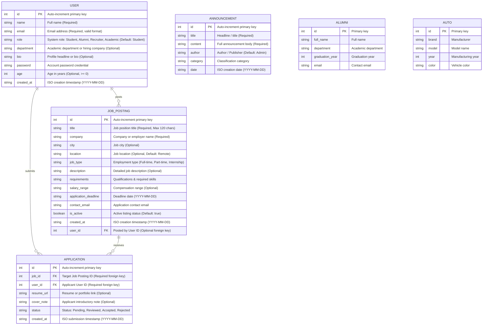

# Data Design Document (DDD)

[← Back to Project README](README.md)

**Project:** Classroom MVC REST API & Management System  
**Version:** 1.0.0  
**Status:** Approved / Active  
**Author:** Department of Management Information Systems  

---

## 1. Executive Summary & Objective

The **Data Design Document (DDD)** details the data architecture, entity definitions, schema specifications, constraints, and persistence lifecycle for the application.

This document serves as the formal specification for:
1. **Domain Entities:** Data models for `User`, `Announcement`, `JobPosting` (`job_postings`), and `Application` (`applications` table) (and legacy reference entities `Alumni` and `Auto`).
2. **Data Dictionary:** Comprehensive schema specifications, data types, constraints, and validation rules.
3. **Entity Relationships (ERD):** Structural representation of system entities.
4. **Data Lifecycle & Storage Strategy:** In-memory state management, container lifecycle impact (*The Forgetting Test*), and the roadmap for persistent volume storage.

---

## 2. Conceptual Data Architecture

The application adopts the **Model-View-Controller (MVC)** architectural pattern. The **Model Layer** encapsulates:
* **Entity Schemas:** Pydantic models enforcing structural typing and request/response validation.
* **In-Memory & Database Repositories:** Class-based models (`UserModel`, `AnnouncementModel`, `JobPostingModel`, `ApplicationModel`) managing collection state and database sessions.
* **CRUD Abstraction:** Clean separation between data manipulation methods and controller routing.

```
  +-------------------------------------------------------------+
  |                      CONTROLLER LAYER                       |
  |       (UserController, AnnouncementController, APIs)        |
  +-------------------------------------------------------------+
                                 │
                 Validates payload using Pydantic
                                 ▼
  +-------------------------------------------------------------+
  |                         MODEL LAYER                         |
  |  +--------------------+             +--------------------+  |
  |  |     UserModel      |             | AnnouncementModel  |  |
  |  +--------------------+             +--------------------+  |
  |  | - _users: List     |             | - _announcements   |  |
  |  | - _next_id: int    |             | - _next_id: int    |  |
  |  | - create()         |             | - create()         |  |
  |  | - get_all()        |             | - get_all()        |  |
  |  | - get_by_id()      |             | - get_by_id()      |  |
  |  | - update()         |             | - update()         |  |
  |  | - patch()          |             | - patch()          |  |
  |  | - delete()         |             | - delete()         |  |
  |  +--------------------+             +--------------------+  |
  +-------------------------------------------------------------+
                                 │
                    Volatile Execution Context
                                 ▼
  +-------------------------------------------------------------+
  |                    IN-MEMORY RAM STORAGE                    |
  |       (Ephemeral Container Memory - Non-persistent)         |
  +-------------------------------------------------------------+
```

---

## 3. Entity-Relationship Diagram (ERD)



---

## 4. Data Dictionary & Schema Specifications

### 4.1. `User` Entity

The `User` entity models individual system users for both web directory management and programmatic REST API consumption.

| Field Name | Data Type | Nullable | Default | Constraints & Rules | Description |
|---|---|---|---|---|---|
| `id` | `Integer` | No | Auto-increment | Primary Key, Unique, Generated by system | Unique identifier for the user record. |
| `name` | `String` | No | None | `min_length=1`, Whitespace trimmed | Full legal name of the user. |
| `email` | `String` | Yes | `None` | Valid email format (RFC 5322 compliant) | Primary contact and login email address. |
| `role` | `String` | No | `"Student"` | Allowed: `Admin`, `Student`, `Alumni`, `Recruiter`, `Academic` | System role defining permissions and capabilities. |
| `department` | `String` | Yes | `None` | `max_length=100` | Academic department or hiring company name. |
| `bio` | `Text` | Yes | `None` | Multi-line text allowed | Profile headline, bio, or brief background. |
| `password` | `String` | Yes | `None` | `min_length=6` | Account password or credential hash. |
| `age` | `Integer` | Yes | `None` | `0 <= age <= 120` | User's age in years. |
| `created_at` | `String` | Yes | Current Date | Format: `YYYY-MM-DD` | Date of account creation or registration. |

#### 4.1.1. User Roles & Permissions Matrix

The Alumni platform distinguishes five core user roles across academic, career, and system management workflows:

| Role Name | Description & Persona | Platform Permissions & Responsibilities |
|---|---|---|
| **`Admin`** | System Super-Administrators (e.g. Sude Doğan). | • Exclusive access to the **UniBridge Admin Panel** (`/admin/`)<br>• Full CRUD data manipulation across all models (Users, Announcements, Jobs, Applications)<br>• Reassign user roles dynamically, delete records, toggle job status<br>• Publish institutional bulletins and system-wide announcements |
| **`Student`** | Currently enrolled university students looking for internships, entry-level opportunities, and campus events. | • Browse all published job postings<br>• Submit job applications with resume and cover note<br>• View announcements & bulletins<br>• View public alumni profiles |
| **`Alumni`** | Graduated alumni who network, mentor current students, and post career openings. | • All `Student` permissions<br>• Publish new job openings and internship referrals<br>• Participate in mentorship networking |
| **`Recruiter`** | Corporate HR representatives, talent acquisition managers, and partner company employers. | • Publish and manage corporate job postings (`POST`, `PUT`, `DELETE /api/job-postings`)<br>• Review submitted applications (`/applications/`)<br>• Update candidate review status (`Pending` ➔ `Reviewed` ➔ `Accepted` / `Rejected`) |
| **`Academic`** | Department chairs, faculty professors, and course instructors. | • Publish and edit official department notices (`/announcements/`)<br>• View academic alumni and student directory (`/users/`) |

#### 4.1.2. Authentication & Admin RBAC Architecture

1. **Authentication Middleware (`middlewares/auth.py`)**:
   - Intercepts all incoming requests in the pipeline.
   - Extracts session credentials from HTTP cookies (`session_token`) or `Authorization: Bearer <token>` headers.
   - Injects the authenticated user identity into `request.state.user`.
   - Protects `/admin/` and `/api/admin/*` routes:
     - Unauthenticated requests: Web clients redirected to `/login/?next=/admin/`; API clients receive `401 Unauthorized`.
     - Non-Admin roles: Web clients receive `403 Forbidden` with an official Istanbul University explanation card; API clients receive `403 Forbidden` JSON.
2. **Admin Control Dashboard (`/admin/`)**:
   - Single-page responsive operations center with tabs for **Users**, **Announcements**, **Job Postings**, and **Applications**.
   - Immediate role switching, record editing, and cascading deletions with CSRF/session validation.

#### Pydantic Schema Variations (DTOs):
1. **`UserBase`**: Core attributes shared across creation and reading (`name`, `email`, `role`, `department`, `bio`, `age`).
2. **`UserCreate`**: Payload received on `POST /api/users/` (does not require `id` or `created_at`).
3. **`UserRegister`**: Registration payload received on `POST /register/` or `POST /api/auth/register` (includes `name`, `email`, `password`, `role`, `department`, `age`, `bio`).
4. **`UserUpdate`**: Payload received on `PUT /api/users/{id}` (full replacement of mutable fields).
5. **`UserPatch`**: Payload received on `PATCH /api/users/{id}` (all fields optional, partial update).
6. **`User`**: Full public representation returned in responses including system-generated `id`, `role`, and `created_at` (omits sensitive password hashes).

---

### 4.2. `Announcement` Entity

The `Announcement` entity represents institutional and departmental notices displayed on the web interface and published via the API.

| Field Name | Data Type | Nullable | Default | Constraints & Rules | Description |
|---|---|---|---|---|---|
| `id` | `Integer` | No | Auto-increment | Primary Key, Unique, Generated by system | Unique identifier for the announcement. |
| `title` | `String` | No | None | `min_length=1`, `max_length=255` | Headline of the announcement. |
| `content` | `String` | No | None | Multi-line text allowed | Detailed announcement message text. |
| `author` | `String` | Yes | `"Admin"` | Trimmed string | Name of publisher or issuing department. |
| `category` | `String` | Yes | `"General"` | Allowed: `Academic`, `General`, `Events`, `Urgent` | Category tag used for visual badges. |
| `date` | `String` | Yes | Current Date | Format: `YYYY-MM-DD` | Date of publication. |

#### Pydantic Schema Variations (DTOs):
1. **`AnnouncementBase`**: Core announcement fields (`title`, `content`, `author`, `category`, `date`).
2. **`AnnouncementCreate`**: Request payload for `POST /api/announcements/`.
3. **`AnnouncementUpdate`**: Request payload for `PUT /api/announcements/{id}`.
4. **`AnnouncementPatch`**: Request payload for `PATCH /api/announcements/{id}`.
5. **`Announcement`**: Response model containing persistent `id`.

---

### 4.3. `JobPosting` (`job_postings`) Entity

The `JobPosting` entity represents career opportunities, internship openings, and corporate postings available for students and alumni.

| Field Name | Data Type | Nullable | Default | Constraints & Rules | Description |
|---|---|---|---|---|---|
| `id` | `Integer` | No | Auto-increment | Primary Key, Unique, Generated by system | Unique identifier for the job posting. |
| `title` | `String` | No | None | `min_length=1`, `max_length=120`, Trimmed | Job title or position name (Required, max 120 characters). |
| `company` | `String` | No | None | `min_length=1`, Trimmed | Name of the hiring company or employer (Required). |
| `city` | `String` | Yes | `None` | `max_length=100`, Optional | City location (Optional, e.g. Istanbul, Izmir). |
| `location` | `String` | Yes | `"Remote"` | `max_length=255`, Optional | Office location or remote status (Default: Remote / City fallback). |
| `job_type` | `String` | Yes | `"Full-time"` | Allowed: `Full-time`, `Part-time`, `Internship`, `Contract` | Employment type classification. |
| `description` | `Text` | Yes | `None` | Multi-line allowed, Optional | Detailed job description or responsibilities (Optional). |
| `requirements` | `Text` | Yes | `None` | Multi-line allowed | Required skills, qualifications, or experience. |
| `salary_range` | `String` | Yes | `None` | `max_length=100` | Optional salary expectation or compensation range. |
| `application_deadline` | `String` | Yes | `None` | Format: `YYYY-MM-DD` | Last date to submit applications. |
| `contact_email` | `String` | Yes | `None` | Valid email format (RFC 5322 compliant) | Application submission email or recruiter contact. |
| `is_active` | `Boolean` | No | `True` | Boolean (`True` / `False`) | Status indicating whether applications are open. |
| `created_at` | `String` | Yes | Current Date | Format: `YYYY-MM-DD` | Date of posting creation. |
| `user_id` | `Integer` | Yes | `None` | Foreign Key (`users.id`), Optional | ID of the user / recruiter who published the posting. |

#### Pydantic Schema Variations (DTOs):
1. **`JobPostingBase`**: Core attributes shared across creation and reading (`title` [max 120], `company`, `city` [optional], `location`, `job_type`, `description` [optional], `requirements`, `salary_range`, `application_deadline`, `contact_email`, `user_id`).
2. **`JobPostingCreate`**: Request payload for `POST /api/job-postings/` (`title` required max 120, `company` required, `city` & `description` optional).
3. **`JobPostingUpdate`**: Request payload for `PUT /api/job-postings/{id}` (full replacement of mutable fields).
4. **`JobPostingPatch`**: Request payload for `PATCH /api/job-postings/{id}` (all fields optional, partial update).
5. **`JobPosting`**: Full response representation including system-generated `id`, `is_active`, and `created_at`.

---

### 4.4. `Application` (`applications`) Entity

The `Application` entity models a job application submitted by a student or user for a specific job posting. It acts as an association entity between `User` and `JobPosting` enriched with candidate profile data.

| Field Name | Data Type | Nullable | Default | Constraints & Rules | Description |
|---|---|---|---|---|---|
| `id` | `Integer` | No | Auto-increment | Primary Key, Unique, Generated by system | Unique identifier for the job application. |
| `job_id` | `Integer` | No | None | Foreign Key (`job_postings.id`), Cascade Delete | Target job posting identifier. |
| `user_id` | `Integer` | No | None | Foreign Key (`users.id`), Cascade Delete | Applicant user identifier. |
| `resume_url` | `String` | Yes | `None` | `max_length=500`, URL format | Link to candidate's online resume, CV, or portfolio. |
| `cover_note` | `Text` | Yes | `None` | Multi-line text allowed | Candidate's cover note or statement of interest. |
| `status` | `String` | No | `"Pending"` | Allowed: `Pending`, `Reviewed`, `Shortlisted`, `Accepted`, `Rejected` | Review and workflow status of the application. |
| `created_at` | `String` | Yes | Current Date | Format: `YYYY-MM-DD` | Date when application was submitted. |

#### Pydantic Schema Variations (DTOs):
1. **`ApplicationBase`**: Core attributes shared across creation and reading (`job_id`, `user_id`, `resume_url`, `cover_note`, `status`).
2. **`ApplicationCreate`**: Request payload for `POST /api/applications/` (or nested under jobs/users).
3. **`ApplicationUpdate`**: Full update payload for `PUT /api/applications/{id}`.
4. **`ApplicationPatch`**: Partial update payload for `PATCH /api/applications/{id}` (e.g. status changes).
5. **`Application`**: Full response model including `id` and `created_at`.
6. **`ApplicationWithDetails`**: Enriched response model resolving related applicant user details (`applicant_name`, `applicant_email`) and job posting details (`job_title`, `company`).

---

## 5. Data Operations (CRUD Mapping)

| Entity | Operation | HTTP Verb | Endpoint | Responsible Model Method | HTTP Status |
|---|---|---|---|---|---|
| **User** | Create | `POST` | `/api/users/`, `/users/` | `UserModel.create(data)` | `201 Created` |
| **User** | Read All | `GET` | `/api/users/`, `/users/` | `UserModel.get_all()` | `200 OK` |
| **User** | Read Single | `GET` | `/api/users/{id}`, `/users/{id}` | `UserModel.get_by_id(id)` | `200 OK` / `404 Not Found` |
| **User** | Full Update | `PUT` | `/api/users/{id}`, `/users/{id}` | `UserModel.update(id, data)` | `200 OK` / `404 Not Found` |
| **User** | Partial Update | `PATCH` | `/api/users/{id}`, `/users/{id}` | `UserModel.patch(id, data)` | `200 OK` / `404 Not Found` |
| **User** | Delete | `DELETE` | `/api/users/{id}`, `/users/{id}` | `UserModel.delete(id)` | `200 OK` / `404 Not Found` |
| **Announcement** | Create | `POST` | `/api/announcements/`, `/announcements/` | `AnnouncementModel.create(data)` | `201 Created` |
| **Announcement** | Read All | `GET` | `/api/announcements/`, `/announcements/` | `AnnouncementModel.get_all()` | `200 OK` |
| **Announcement** | Read Single | `GET` | `/api/announcements/{id}`, `/announcements/{id}` | `AnnouncementModel.get_by_id(id)` | `200 OK` / `404 Not Found` |
| **Announcement** | Full Update | `PUT` | `/api/announcements/{id}`, `/announcements/{id}` | `AnnouncementModel.update(id, data)` | `200 OK` / `404 Not Found` |
| **Announcement** | Partial Update | `PATCH` | `/api/announcements/{id}`, `/announcements/{id}` | `AnnouncementModel.patch(id, data)` | `200 OK` / `404 Not Found` |
| **Announcement** | Delete | `DELETE` | `/api/announcements/{id}`, `/announcements/{id}` | `AnnouncementModel.delete(id)` | `200 OK` / `404 Not Found` |
| **JobPosting** | Create | `POST` | `/api/job-postings/`, `/job-postings/` | `JobPostingModel.create(data)` | `201 Created` |
| **JobPosting** | Read All | `GET` | `/api/job-postings/`, `/job-postings/` | `JobPostingModel.get_all()` | `200 OK` |
| **JobPosting** | Read Single | `GET` | `/api/job-postings/{id}`, `/job-postings/{id}` | `JobPostingModel.get_by_id(id)` | `200 OK` / `404 Not Found` |
| **JobPosting** | Full Update | `PUT` | `/api/job-postings/{id}`, `/job-postings/{id}` | `JobPostingModel.update(id, data)` | `200 OK` / `404 Not Found` |
| **JobPosting** | Partial Update | `PATCH` | `/api/job-postings/{id}`, `/job-postings/{id}` | `JobPostingModel.patch(id, data)` | `200 OK` / `404 Not Found` |
| **JobPosting** | Delete | `DELETE` | `/api/job-postings/{id}`, `/job-postings/{id}` | `JobPostingModel.delete(id)` | `200 OK` / `404 Not Found` |
| **Application** | Create | `POST` | `/api/applications/`, `/applications/` | `ApplicationModel.create(data)` | `201 Created` |
| **Application** | Read All | `GET` | `/api/applications/`, `/applications/` | `ApplicationModel.get_all()` | `200 OK` |
| **Application** | Read Single | `GET` | `/api/applications/{id}`, `/applications/{id}` | `ApplicationModel.get_by_id(id)` | `200 OK` / `404 Not Found` |
| **Application** | Full Update | `PUT` | `/api/applications/{id}`, `/applications/{id}` | `ApplicationModel.update(id, data)` | `200 OK` / `404 Not Found` |
| **Application** | Partial Update | `PATCH` | `/api/applications/{id}`, `/applications/{id}` | `ApplicationModel.patch(id, data)` | `200 OK` / `404 Not Found` |
| **Application** | Delete | `DELETE` | `/api/applications/{id}`, `/applications/{id}` | `ApplicationModel.delete(id)` | `200 OK` / `404 Not Found` |
| **Application (Nested)** | Submit Job Application | `POST` | `/api/job-postings/{job_id}/applications` | `ApplicationModel.create_for_job(job_id, data)` | `201 Created` / `404 Not Found` |
| **Application (Nested)** | List Job Applications | `GET` | `/api/job-postings/{job_id}/applications` | `ApplicationModel.get_all(job_id=job_id)` | `200 OK` / `404 Not Found` |
| **Application (Nested)** | List User Applications | `GET` | `/api/users/{user_id}/applications` | `ApplicationModel.get_all(user_id=user_id)` | `200 OK` / `404 Not Found` | |

---

## 6. Storage Lifecycle & Persistence Architecture

### 6.1. Active Phase: Relational Database Persistence (Production & Docker)
* **Database Engine:** PostgreSQL 15 (`postgres:15-alpine`) inside Docker, with automatic SQLite fallback (`app.db`) for local standalone execution.
* **Volume Persistence:** Data is stored in the Docker named volume `postgres_data:/var/lib/postgresql/data`. When running `docker compose down`, container processes stop but volume data is preserved.
* **ORM & Session Management:** Managed via SQLAlchemy 2.0 (`SessionLocal`), binding Pydantic DTOs with `UserEntity`, `AnnouncementEntity`, `JobPostingEntity` (`job_postings`), and `ApplicationEntity` (`applications`) database tables.

### 6.2. Migrations, Factories & Seeding Pipeline
1. **Environment Variables (`.env`):**
   * Sensitive credentials (`POSTGRES_USER`, `POSTGRES_PASSWORD`, `DATABASE_URL`) are stored in `.env` and excluded from version control via `.gitignore`.
   * Committed template provided as `.env.example`.
2. **Schema Versioning with Alembic:**
   * Automated migrations located in `alembic/versions/` (e.g. `21c02eef3fb8_create_users_and_announcements_tables.py`, `ed325ba68409_create_job_postings_table.py`).
   * Migrations are executed with `alembic upgrade head`.
3. **Factories & Seeding (`seed.py`):**
   * Uses Faker via `UserFactory` and `AnnouncementFactory` to generate realistic synthetic testing data.
   * `seed.py` seeds baseline records (Emre Yilmaz, Sude Dogan, faculty notices) plus configurable batches of factory entities.

---

## 7. Data Integrity & Validation Matrix

* **Type Safety:** Enforced via Python type hints and Pydantic v2 runtime validation.
* **Error Handling:**
  * Missing required fields (`name`, `title`, `content`, `company`, `description`, `job_id`, `user_id`) trigger `422 Unprocessable Entity` with automated field error paths.
  * Non-existent ID lookups trigger `404 Not Found` with human-readable error details.
* **Auto-Increment Guarantees:** Thread-safe class variable counters (`_next_id`) guarantee strictly monotonic ID sequence during in-memory lifecycle.

---

## 8. Document Metadata & Approval

* **Document Version:** 1.2.0 (Added `applications` table specification)
* **Related Code Modules:**
  * Models: [`models/user.py`](./models/user.py), [`models/announcement.py`](./models/announcement.py), [`models/job_posting.py`](./models/job_posting.py), [`models/application.py`](./models/application.py)
  * Controllers: [`controllers/`](./controllers/)
  * Views: [`views/`](./views/)
* **Parent Architecture Document:** [`README.md`](./README.md)
